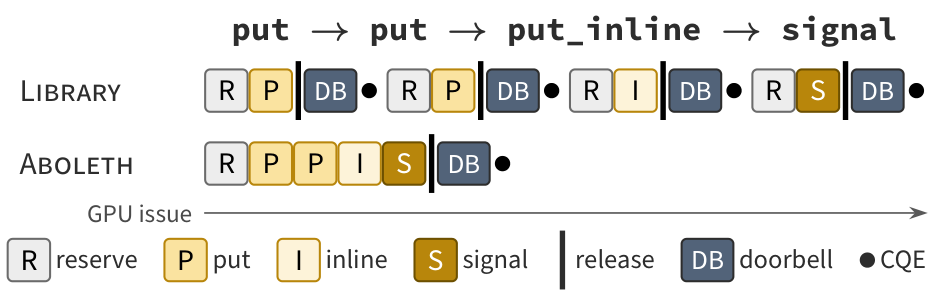
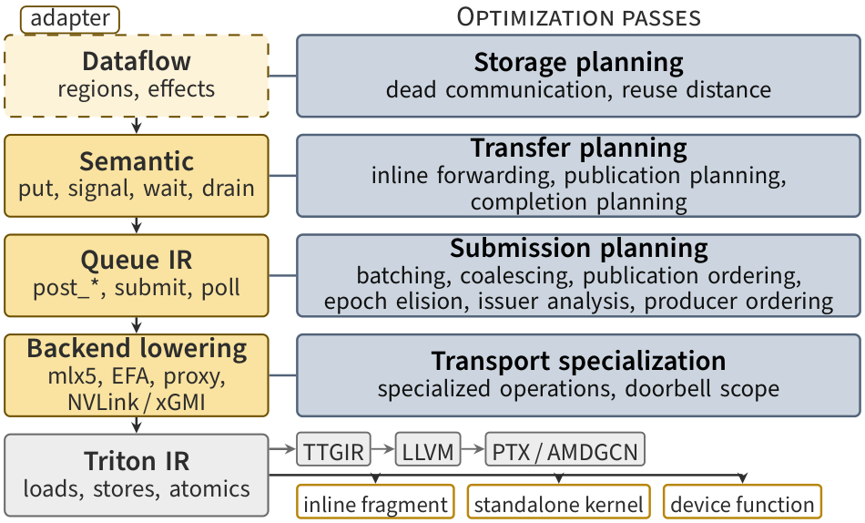
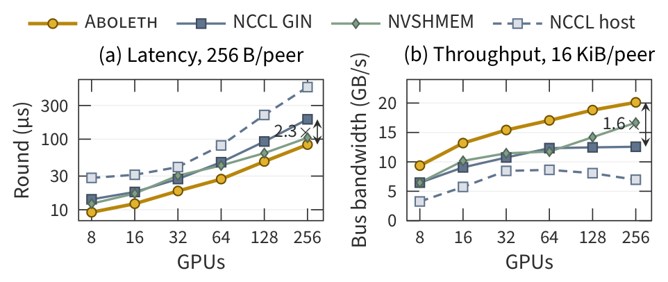
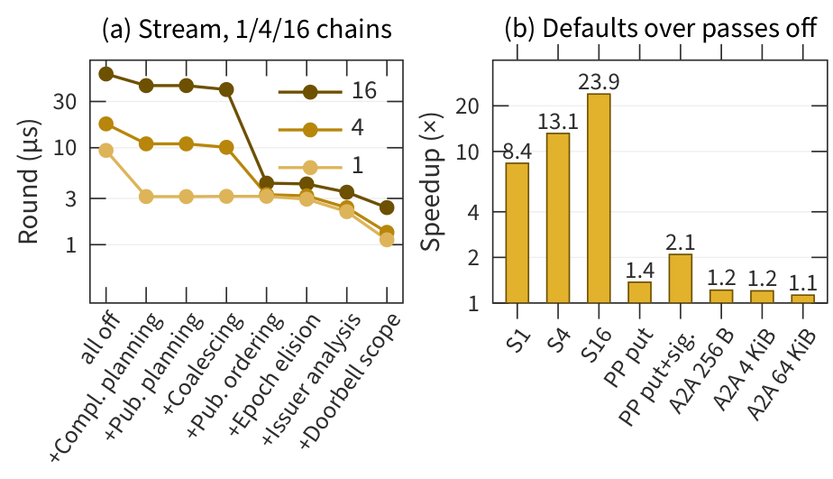
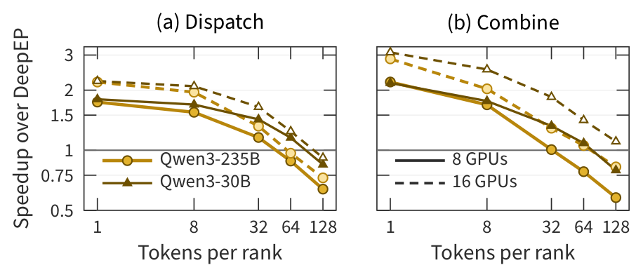

# Aboleth

**A compiler for GPU-initiated communication.**

Communication libraries such as NVSHMEM and NCCL's device API ship generic
device functions: every call reserves a queue slot, orders memory, rings a
doorbell and tracks completion for the general case. Aboleth makes
communication part of the kernel's intermediate representation instead. It
sees the puts, signals and waits together with the computation around them,
plans completion around buffer lifetimes, and emits transport code
specialized to the program: batched work requests, the weakest sufficient
memory ordering, one doorbell per batch.

<p align="center">
  
  <br><em>Posting a chain of commands: a library pays a reservation, release,
  doorbell and completion per call; Aboleth posts the chain with one of each.</em>
</p>

Aboleth is an MLIR dialect and pass pipeline loaded into an unmodified
[Triton](https://github.com/triton-lang/triton) as a plugin, plus a host
runtime. It targets GPU-initiated RDMA on NVIDIA ConnectX NICs (mlx5), a host
proxy, NVLink/peer memory, AWS EFA and, experimentally, AMD GPUs with
Pensando Ionic NICs.

## Warning: Experimental repo

Aboleth is an experimental research compiler. The API and ABI may change
unexpectedly and break backwards compatibility.

## Getting started

Aboleth needs Linux, an NVIDIA Hopper or Blackwell GPU, the CUDA toolkit and
Python 3.12. GPU-initiated RDMA also needs rdma-core and an mlx5 NIC. The
unprivileged *staged* path works without extra setup; GPU-rung doorbells
need root or `PeerMappingOverride=1`.

```bash
git clone --recurse-submodules https://github.com/ParCoreLab/aboleth.git
cd aboleth
./repro/bootstrap.sh                 # pinned venv, Triton, full build
ctest --preset quick                 # compiler, goldens, Python, lint
ctest --test-dir build -L smoke      # GPU smoke tests
```

[`docs/BUILDING.md`](docs/BUILDING.md) covers requirements, backends and
their status, build presets and configuration, and the test suite.
[`repro/README.md`](repro/README.md) lists the pinned environment and tested
platforms.

## Using Aboleth

Aboleth is used at two tiers ([`docs/TIERS.md`](docs/TIERS.md)).

### Tier 1: a generated device library

For existing CUDA code, Aboleth generates an NVSHMEM-shaped device library
from the same lowering. `world.device_library()` returns its header
(`aboleth/device.cuh`), a static archive and per-op bitcode:

```cpp
#include <aboleth/device.cuh>

__global__ void exchange(aboleth::DeviceContext ctx, int peer,
                         aboleth::RemoteRegion dst, aboleth::LocalRegion src,
                         uint32_t bytes, aboleth::RemoteRegion flag,
                         const uint64_t* my_flag, uint64_t epoch) {
  if (threadIdx.x != 0) return;
  aboleth::put_signal(ctx, peer, dst, src, bytes, flag, epoch);  // one batch
  aboleth::quiet(ctx, peer);                  // source buffer reusable
  aboleth::wait_signal(ctx, my_flag, epoch);  // peer's data arrived
}
```

The same library binds into Triton (`aboleth.frontends.triton.tier1`) and
CuTe DSL (`aboleth.frontends.cute`) kernels.

### Tier 2: communication inside Triton kernels

Communication operations sit next to the computation, so the compiler sees
sizes, offsets, predicates and dependencies. An all-to-all with one program
per peer (condensed from
[`experiments/bench/tier2.py`](experiments/bench/tier2.py)):

```python
import triton
import triton.language as tl
import aboleth.language as aboleth

@triton.jit
def alltoall(endpoints, recv, flags, send, send_key, my_flags, epoch,
             BYTES: tl.constexpr, RANK: tl.constexpr):
    pid = tl.program_id(0)
    peer = pid + (pid >= RANK).to(tl.int32)        # one program per peer
    ep = aboleth.endpoint(endpoints, peer)          # this program owns it
    dst = aboleth.remote(recv, peer)
    flag = aboleth.remote(flags, peer, tl.int64)
    src = send.to(tl.pointer_type(tl.int8)) + peer * BYTES

    t = aboleth.put(ep, dst.at(RANK * BYTES), src, BYTES, source_key=send_key)
    s = aboleth.signal(ep, flag.at(RANK), epoch, after=t)
    aboleth.wait_signal(my_flags + peer, epoch)     # the peer's slice arrived
    aboleth.wait(s)                                 # our send buffer is free
```

The host connects a `World`, registers memory and exchanges region tables;
kernels launched under `world.compilation()` go through the Aboleth passes:

```python
import torch, aboleth

boot = aboleth.TcpStoreBootstrap.from_env()        # MASTER_ADDR, RANK, WORLD_SIZE
n = boot.world_size
world = aboleth.World(boot.rank, n, device=torch.cuda.current_device(),
                      bootstrap=boot)
world.connect_all("rdma")                          # or "p2p", "proxy", "auto"

buf = torch.zeros(2 * n * BYTES + 8 * n, dtype=torch.uint8, device="cuda")
reg = world.register(buf)
table = world.exchange_regions({
    "send":  world.region("send", reg, offset=0, length=n * BYTES),
    "recv":  world.region("recv", reg, offset=n * BYTES, length=n * BYTES),
    "flags": world.region("flags", reg, offset=2 * n * BYTES, length=8 * n),
})
send = table.local("send")
my_flags = buf[2 * n * BYTES:].view(torch.int64)

with world.compilation():
    alltoall[(n - 1,)](table.endpoint_handles.view(torch.int64),
                       table.regions("recv"), table.regions("flags"),
                       send.address, send.lkey, my_flags, 1,
                       BYTES=BYTES, RANK=boot.rank)
```

### In vLLM

The [vLLM integration](integrations/vllm) adds Aboleth as an expert-parallel
all-to-all backend whose dispatch and combine are compiled MoE programs:

```bash
git -C vllm apply aboleth/integrations/vllm/0001-aboleth-all2all-backend.patch
vllm serve <model> --enable-expert-parallel \
    --all2all-backend aboleth --moe-backend triton
```

## How it works

<p align="center">
  
</p>

A kernel states *what* it communicates: semantic `put`, `signal`, `wait` and
`drain` operations, the regions they touch, and when buffers are reused.
Each IR level exposes facts the passes at that level use:

- **Storage planning** removes dead communication and sizes buffers from
  reuse distance.
- **Transfer planning** forwards small payloads inline, chooses how each
  signal is published, and decides which transfers need completions.
- **Submission planning** batches commands, coalesces doorbells, orders
  publications, elides epochs and finds which thread owns each queue.
- **Transport specialization** lowers to the selected backend and doorbell
  scope.

The output is ordinary Triton IR, so it fuses with the surrounding compute;
it can also be exported as an inline fragment, a standalone kernel or a
device function.

## Results

From the paper, on H100 nodes (4 GPUs each, NVLink and 200 Gb/s InfiniBand)
and B200 nodes; the paper has the full methodology.

<p align="center">
  
  <br><em>All-to-all on 8–256 H100 GPUs against NCCL GIN, NVSHMEM and NCCL
  host: (a) round latency at 256 B per peer, (b) bus bandwidth at 16 KiB per
  peer.</em>
</p>

<p align="center">
  
  <br><em>What the passes buy in Tier-2 kernels: (a) streams of 1, 4 and 16
  put+signal chains as passes are added in pipeline order; (b) the defaults
  over all switchable passes off.</em>
</p>

<p align="center">
  
  <br><em>Compiled MoE dispatch and combine over DeepEP on H100, one FP8
  layer.</em>
</p>

In vLLM, Aboleth serves Qwen3-235B on 16 B200 GPUs and answers requests up
to 1.29× faster than with DeepEP.

## Documentation

- [`docs/TIERS.md`](docs/TIERS.md): the two tiers and framework adapters
- [`docs/PROGRAMMING_MODEL.md`](docs/PROGRAMMING_MODEL.md): patterns,
  effects and semantic transport operations
- [`docs/COMPILER_SEMANTICS.md`](docs/COMPILER_SEMANTICS.md): the passes and
  what they may legally do
- [`docs/ARCHITECTURE.md`](docs/ARCHITECTURE.md): the pipeline and the
  ownership boundary between Aboleth and its clients
- [`docs/WORLD.md`](docs/WORLD.md), [`docs/RDMA_ABI.md`](docs/RDMA_ABI.md),
  [`docs/PROXY_ABI.md`](docs/PROXY_ABI.md), [`docs/EFA_ABI.md`](docs/EFA_ABI.md):
  runtime and transport ABIs
- [`docs/COMPILED_MOE.md`](docs/COMPILED_MOE.md),
  [`docs/VLLM_INTEGRATION.md`](docs/VLLM_INTEGRATION.md),
  [`docs/KV_CACHE.md`](docs/KV_CACHE.md) (experimental): clients
- [`experiments/bench/README.md`](experiments/bench/README.md): the
  benchmark suite and evaluation matrix
- [`CONTRIBUTING.md`](CONTRIBUTING.md): development loop and invariants

## Citing

TBD

## License

Apache License 2.0; see [`LICENSE`](LICENSE) and [`NOTICE`](NOTICE).
Vendored third-party headers keep their own BSD-compatible licenses, listed
in `NOTICE`.
